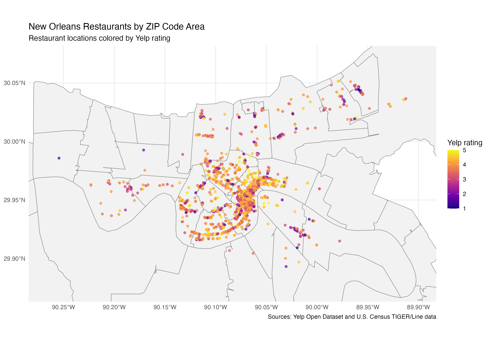
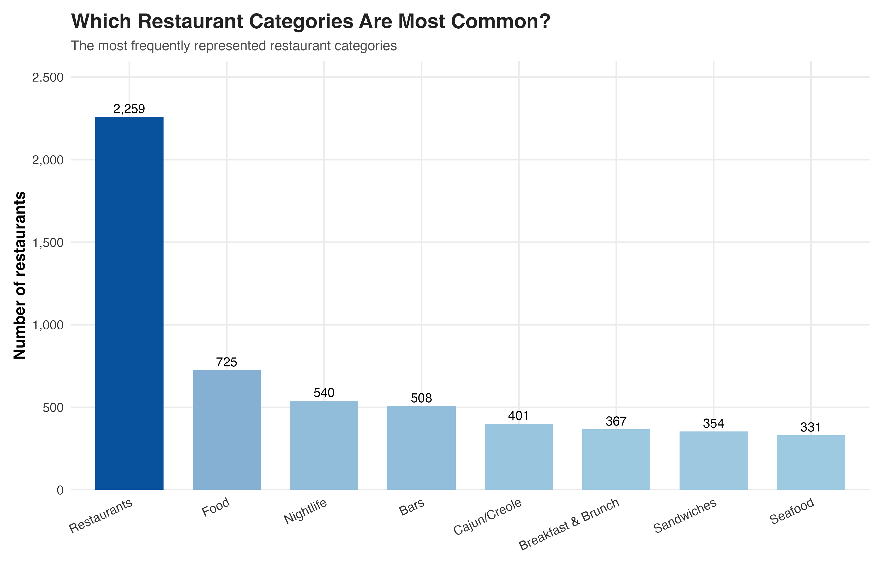
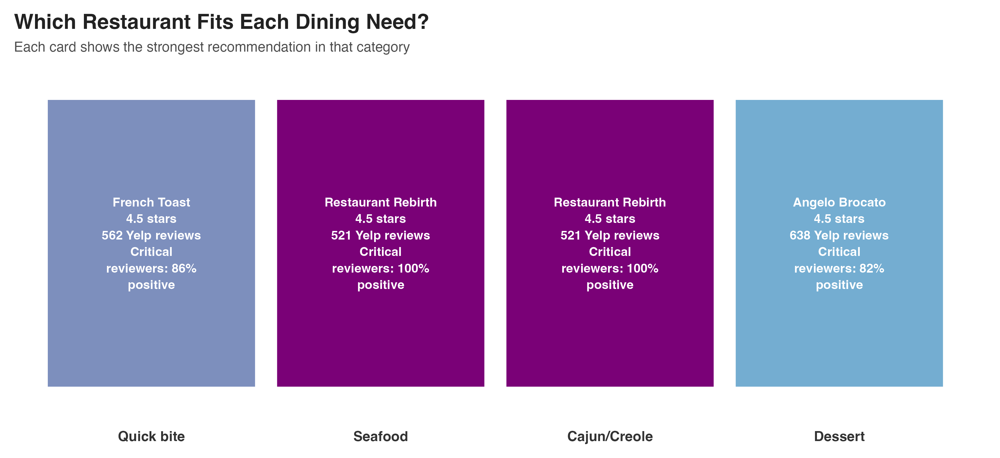
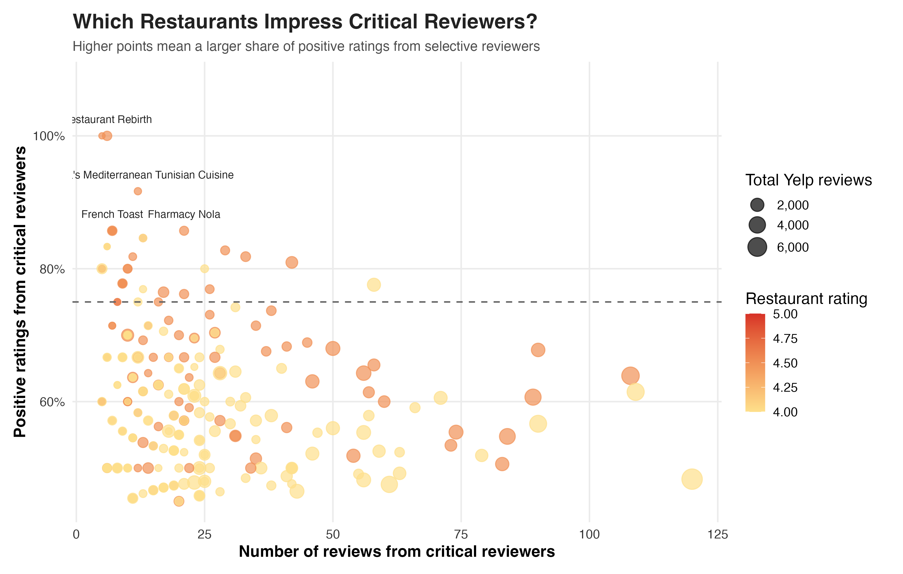
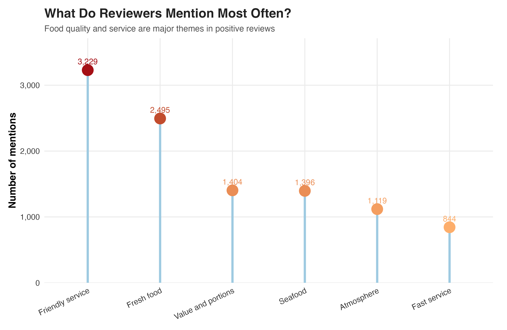

# New Orleans Restaurant Guide Using Yelp Data

## Can Yelp data help visitors choose a New Orleans restaurant?

This project analyzes Yelp restaurant data from New Orleans, Louisiana. The goal is to identify restaurants for different dining needs and explain why they were recommended.

The recommendations use:

- Yelp star ratings
- Number of Yelp reviews
- Restaurant category
- Ratings from critical reviewers
- Common themes in positive reviews

---

## Main Research Question

**Which New Orleans restaurants are best suited for different dining needs, and what do Yelp reviewers say about those restaurants?**

The project focuses on practical questions a visitor might ask:

- Where are restaurants concentrated?
- Which restaurant categories are most common?
- What is a good place for a quick bite?
- Where can visitors find seafood?
- Which restaurants are good choices for Cajun or Creole food?
- Where can visitors go for dessert?
- Which restaurants impress reviewers who are usually more critical?
- What do reviewers say about the recommended restaurants?

---

## Study Region

I selected **New Orleans, Louisiana** because it is a major food and tourism destination with many restaurants and Yelp reviews.

The analysis included:

- **2,259 New Orleans restaurants**
- **476,421 restaurant reviews**
- **29 ZIP Code Tabulation Areas**

I compared ZIP Code Tabulation Areas with Census tracts. ZIP Code Tabulation Areas were selected as the primary geographic system because they assigned all 2,259 restaurants to an area.

| Geographic system | Number of areas | Restaurants assigned | Unmatched restaurants |
|---|---:|---:|---:|
| ZIP Code Tabulation Areas | 29 | 2,259 | 0 |
| Census tracts | 145 | 2,202 | 57 |

---

## Data Preparation

The Yelp Open Dataset was downloaded, unzipped, and imported into R.

The data was filtered to include businesses that:

- Were located in Louisiana
- Were located in New Orleans
- Included “Restaurants” in their business categories

The large original JSON files were saved locally and excluded from GitHub using `.gitignore`. The filtered restaurant and review data were saved as RDS files for more efficient analysis.

---

## How Were Restaurants Recommended?

A restaurant was considered a strong recommendation when it had:

- At least 4 stars
- At least 100 Yelp reviews
- At least 5 reviews from critical reviewers
- Positive ratings from critical reviewers
- A relevant restaurant category
- Positive review themes

A **critical reviewer** was defined as a reviewer who:

- Had written at least 10 reviews in the available dataset
- Had an average rating of 3.5 stars or lower

A positive rating from a critical reviewer means a rating of 4 or 5 stars.

---

# Findings

## 1. Where are restaurants concentrated?

### Answer

**ZIP Code 70130 has the largest concentration of restaurants, with 588 restaurants.**

ZIP Code Tabulation Areas were used for the main geographic analysis because every restaurant was assigned to one.

### Restaurant concentration map

[View the ZIP Code summary table](figures/zip_restaurant_summary.csv)

---

## 2. Which restaurant categories are most common?

### Answer

The most common restaurant categories include:

- Cajun/Creole
- Breakfast & Brunch
- Sandwiches
- Seafood
- American restaurants

This shows that New Orleans Yelp restaurants include both traditional local food and many casual dining choices.

[View the restaurant category table](figures/category_counts.csv)

[R code for this analysis](R/02_categories.R)

---

## 3. Which restaurants fit different dining needs?

### Answer

The recommendations below identify one strong restaurant for each dining need.

| Dining need | Recommended restaurant |
|---|---|
| Quick bite | French Toast |
| Seafood | Restaurant Rebirth |
| Cajun/Creole food | Restaurant Rebirth |
| Dessert | Angelo Brocato |

These recommendations are based on Yelp ratings, review counts, restaurant categories, and support from critical reviewers.

Supporting tables:

- [Quick-bite recommendations](figures/quick_bite_recommendations.csv)
- [Seafood recommendations](figures/seafood_recommendations.csv)
- [Cajun and Creole recommendations](figures/cajun_creole_recommendations.csv)
- [Dessert recommendations](figures/dessert_recommendations.csv)

[R code for this analysis](R/07_restaurant_recommendations.R)

---

## 4. Which restaurants impress critical reviewers?

### Answer

Some restaurants received strong ratings even from reviewers who usually gave lower ratings.

This is useful because a 4-star rating from a critical reviewer may provide stronger evidence than a 5-star rating from someone who gives almost every restaurant 5 stars.

The graph shows:

- The number of reviews from critical reviewers
- The percentage of positive ratings from critical reviewers
- Restaurant star ratings
- The total number of Yelp reviews

[View the critical-reviewer recommendation table](figures/critical_reviewer_restaurant_recommendations.csv)

[R code for this analysis](R/04_picky_reviewer_analysis.R)

---

## 5. What do reviewers mention most often?

### Answer

Positive reviewers most often mention themes related to:

- Fresh and flavorful food
- Friendly service
- Value and portions
- Seafood
- Atmosphere
- Fast service

These themes help explain why a restaurant was recommended instead of relying only on its star rating.

Supporting files:

- [Review theme summary](figures/review_theme_summary.csv)
- [Example reviews](figures/review_examples.csv)

[R code for this analysis](R/05_review_themes.R)

---

## Do More Reviews Mean Higher Ratings?

This graph compares the number of Yelp reviews with restaurant star ratings.

It helps show whether restaurants with many reviews also tend to have high ratings.

---

# Overall Conclusion

The analysis shows that restaurant recommendations should not depend on star ratings alone.

A stronger recommendation considers:

- Restaurant category
- Number of reviews
- Overall rating
- Ratings from critical reviewers
- Positive review themes
- Geographic location

For example, a restaurant may be especially useful for a visitor because it has strong reviews from critical reviewers, offers a specific type of food, or is located in an area with many other restaurants.

These results provide data-based recommendations for New Orleans visitors. They do not identify one universally “best” restaurant.

---

# Limitations

This project uses Yelp data, so the results may not represent every restaurant or every diner in New Orleans.

The data does not identify whether reviewers are tourists or local residents. Therefore, this project does not directly measure tourist behavior.

The recommendations are based on Yelp categories, ratings, review counts, critical-reviewer ratings, and review text. They should be interpreted as data-based recommendations rather than objective statements about the single best restaurant.

---

# R Code

All analysis was completed in R.

- [Data import, filtering, and RDS creation](R/01_import_and_filter.R)
- [Restaurant category analysis](R/02_categories.R)
- [Restaurant performance analysis](R/03_restaurant_analysis.R)
- [Critical-reviewer analysis](R/04_picky_reviewer_analysis.R)
- [Review-theme analysis](R/05_review_themes.R)
- [Geographic analysis and maps](R/06_geography_analysis.R)
- [Restaurant recommendations](R/07_restaurant_recommendations.R)
- [Final graphs and findings](R/08_final_findings.R)

[View the complete R code folder](R/)

---

# View the Project

[View the project through GitHub Pages](https://castro1980.github.io/167R-Project-2/)