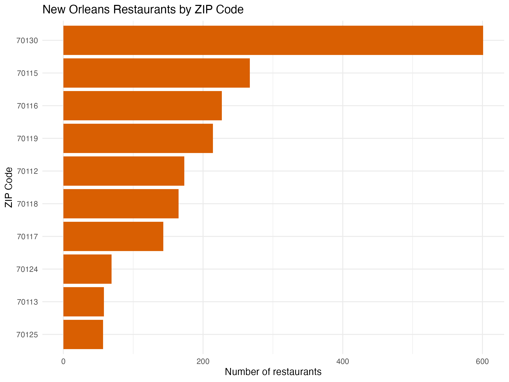
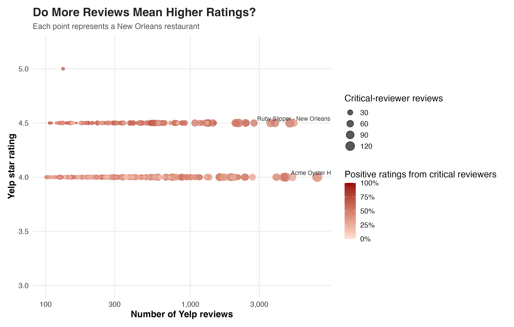

# New Orleans Restaurant Analysis

## Main Research Question

Which New Orleans restaurants are best suited for different dining needs, and what do Yelp reviewers say about those restaurants?

## Supporting Questions

- Where are restaurants concentrated in New Orleans?
- Which restaurant categories are most common?
- Which restaurants are good choices for a quick bite?
- Which restaurants are strong choices for seafood?
- Which restaurants are strong choices for Cajun or Creole food?
- Which restaurants are good choices for dessert?
- Which restaurants receive positive ratings from generally critical reviewers?
- What do reviewers mention about the recommended restaurants?

## Geographic Region

I selected New Orleans, Louisiana, as the study region because it is a major food and tourism destination with many restaurants and Yelp reviews.

I compared two geographic systems:

- ZIP Code Tabulation Areas (ZCTAs)
- Census tracts

I selected ZIP Code Tabulation Areas as the primary geographic system because they assigned all 2,259 restaurants to a geographic area. Census tracts left 57 restaurants unmatched. ZCTAs also created 29 areas, which are easier to interpret than 145 Census tracts.

## Data Preparation

I used the Yelp Open Dataset. The large JSON files were downloaded, unzipped, and imported into R.

The data was filtered to include businesses that:

- Were located in Louisiana
- Were located in New Orleans
- Included “Restaurants” in their business categories

This produced a dataset of 2,259 New Orleans restaurants. The restaurant and review data were saved as RDS files for more efficient analysis.

The original large JSON files were kept locally and excluded from GitHub using `.gitignore`.

## Definition of a Strong Restaurant

A restaurant was considered a strong recommendation when it had:

- A rating of at least 4 stars
- At least 100 Yelp reviews
- At least 5 reviews from critical reviewers
- Positive review themes
- A relevant restaurant category

A critical reviewer was defined as a reviewer who:

- Had written at least 10 reviews in the available dataset
- Had an average rating of 3.5 stars or lower

A positive rating from a critical reviewer was defined as a rating of 4 or 5 stars.

The reviewer analysis was calculated using reviews of New Orleans restaurants in this project. It does not represent every Yelp review written by each reviewer.

## Geographic Comparison

| Geographic system | Number of areas | Restaurants assigned | Unmatched restaurants |
|-------------------|-----------------|----------------------|-----------------------|
| ZIP Code Tabulation Areas | 29 | 2,259 | 0 |
| Census tracts | 145 | 2,202 | 57 |

ZIP Code 70130 had the largest number of restaurants in the analysis.

## Restaurant Recommendation Analysis

I created recommendation tables for:

- Seafood restaurants
- Quick-bite restaurants
- Cajun and Creole restaurants
- Dessert restaurants

The review-theme analysis searched positive reviews for mentions of:

- Fresh or delicious food
- Seafood
- Fast service
- Friendly service
- Value and portions
- Atmosphere

These themes help explain why a restaurant was recommended instead of relying only on its star rating.

## Maps and Figures

### Restaurants by ZIP Code

### Restaurants by Census Tract

### Geographic System Comparison

### Restaurants by ZIP Code Count

### Ratings and Review Counts

## Tables

- [Geographic comparison table](figures/geography_comparison.csv)
- [ZIP Code restaurant summary](figures/zip_restaurant_summary.csv)
- [Restaurant category counts](figures/category_counts.csv)
- [Restaurant category pairs](figures/category_pairs.csv)
- [Top-rated restaurants](figures/top_rated_restaurants.csv)
- [Most-reviewed restaurants](figures/most_reviewed_restaurants.csv)
- [Critical-reviewer recommendations](figures/critical_reviewer_restaurant_recommendations.csv)
- [Reviewer summary](figures/reviewer_summary.csv)
- [Review theme summary](figures/review_theme_summary.csv)
- [Review examples](figures/review_examples.csv)
- [Seafood recommendations](figures/seafood_recommendations.csv)
- [Quick-bite recommendations](figures/quick_bite_recommendations.csv)
- [Cajun and Creole recommendations](figures/cajun_creole_recommendations.csv)
- [Dessert recommendations](figures/dessert_recommendations.csv)

## R Code

- [Data import, filtering, and RDS creation](https://github.com/castro1980/167R-Project-2/blob/main/R/01_import_and_filter.R)
- [Restaurant category analysis](https://github.com/castro1980/167R-Project-2/blob/main/R/02_categories.R)
- [Restaurant performance analysis](https://github.com/castro1980/167R-Project-2/blob/main/R/03_restaurant_analysis.R)
- [Critical reviewer analysis](https://github.com/castro1980/167R-Project-2/blob/main/R/04_picky_reviewer_analysis.R)
- [Review theme analysis](https://github.com/castro1980/167R-Project-2/blob/main/R/05_review_themes.R)
- [Geographic analysis and maps](https://github.com/castro1980/167R-Project-2/blob/main/R/06_geography_analysis.R)
- [Restaurant recommendations by dining need](https://github.com/castro1980/167R-Project-2/blob/main/R/07_restaurant_recommendations.R)
- [Complete R code folder](https://github.com/castro1980/167R-Project-2/tree/main/R)

## Limitations

This analysis uses Yelp data, so the results may not represent every restaurant or every diner in New Orleans.

The data does not identify whether reviewers are tourists or local residents. Therefore, the project does not directly measure tourist behavior.

The category recommendations are based on Yelp categories, ratings, review counts, and review text. They should be interpreted as data-based recommendations rather than objective statements about the single “best” restaurant.

## View the Project

[View the project through GitHub Pages](https://castro1980.github.io/167R-Project-2/)