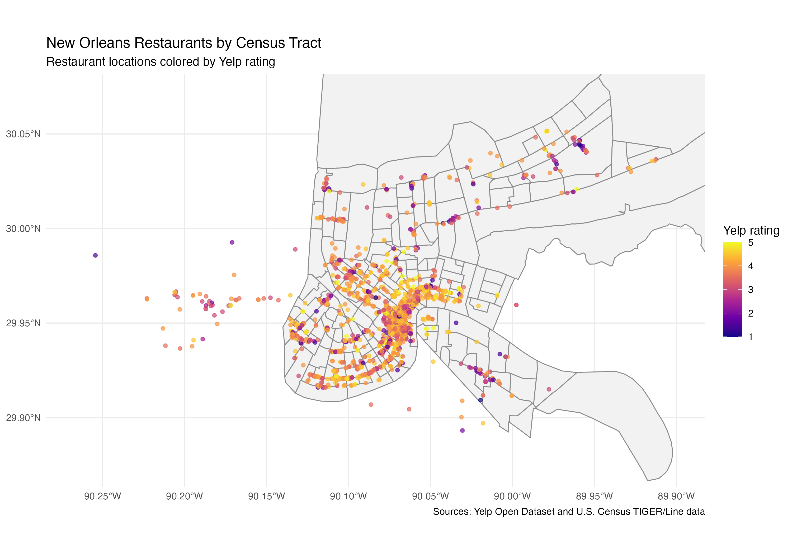
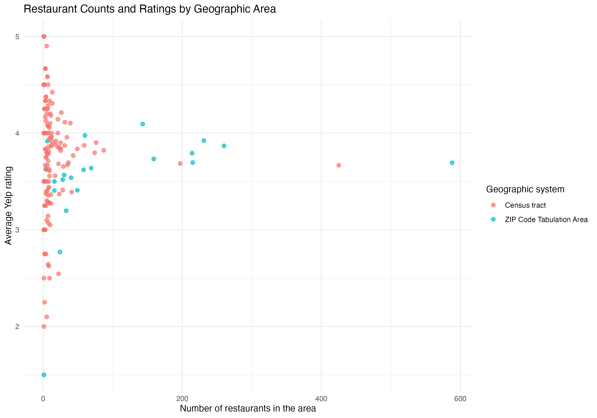

# New Orleans Restaurant Geography Analysis

## Research question

Which geographic system provides the most useful way to compare restaurant locations and ratings in New Orleans?

## Project purpose

This project uses the Yelp Open Dataset to study restaurants in New Orleans. The analysis demonstrates how to import large JSON files, clean and filter data, create spatial points, join restaurants to official geographic boundaries, compare geographic systems, and explain the limitations of each system.

This submission focuses on the analysis through Step 6: choosing and defending a geographic area.

## Geographic systems compared

I compared:

- ZIP Code Tabulation Areas (ZCTAs)
- Census tracts

ZCTAs are Census approximations of ZIP Code areas. Census tracts are smaller statistical areas used for demographic and geographic analysis.

## Geographic system selected

I selected **ZIP Code Tabulation Areas** as the primary geographic system.

ZCTAs assigned all 2,259 New Orleans restaurants to a geographic area. Census tracts left 57 restaurants unmatched. ZCTAs also created 29 areas, which are easier to interpret and compare than 145 Census tracts.

Although Census tracts provide more geographic detail, they divide the restaurants into many smaller areas. This can make comparisons less stable, especially when an area contains only a small number of restaurants. ZCTAs provide a clearer and more complete geographic structure for this analysis.

## Geographic comparison

| Geographic system | Number of areas | Restaurants assigned | Unmatched restaurants | Smallest area count | Largest area count |
|---|---:|---:|---:|---:|---:|
| ZIP Code Tabulation Areas | 29 | 2,259 | 0 | 1 | 588 |
| Census tracts | 145 | 2,202 | 57 | 1 | 425 |

## ZIP Code areas with the most restaurants

| ZIP Code | Number of restaurants | Average rating | Total reviews |
|---|---:|---:|---:|
| 70130 | 588 | 3.69 | 206,480 |
| 70115 | 260 | 3.87 | 46,498 |
| 70116 | 231 | 3.92 | 63,596 |
| 70112 | 215 | 3.70 | 45,394 |
| 70119 | 214 | 3.79 | 33,947 |
| 70118 | 159 | 3.73 | 21,387 |
| 70117 | 143 | 4.09 | 16,987 |
| 70124 | 69 | 3.64 | 7,421 |
| 70113 | 60 | 3.98 | 8,454 |
| 70125 | 58 | 3.62 | 4,769 |

## Maps

### Restaurants by ZIP Code area

### Restaurants by Census tract

### Geographic comparison plot

## Source code

The source code is organized in the `R` folder:

- [Data import, cleaning, filtering, and RDS creation](R/01_import_and_filter.R)
- [Geographic comparison and spatial analysis](R/06_geography_analysis.R)

The geographic comparison table is available here:

- [Geographic comparison table](figures/geography_comparison.csv)

## Data management

The original Yelp JSON files are very large, so they were stored locally in `data/raw/` and excluded from GitHub using `.gitignore`.

The business and review data were filtered to New Orleans and saved as RDS files for more efficient analysis.

## Data sources

- [Yelp Open Dataset](https://business.yelp.com/data/resources/open-dataset/)
- [U.S. Census TIGER/Line data](https://www.census.gov/geographies/mapping-files/time-series/geo/tiger-line-file.html)
- [tigris R package](https://walker-data.com/tigris/)

## View the project

[View the project through GitHub Pages](https://castro1980.github.io/167R-Project-2/)