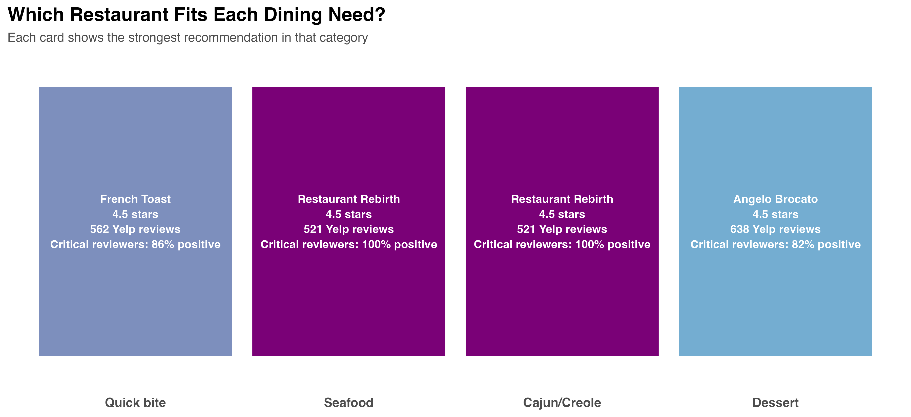
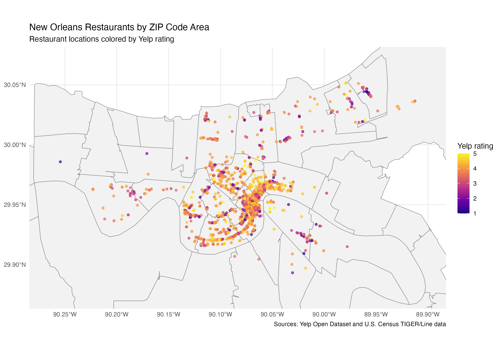
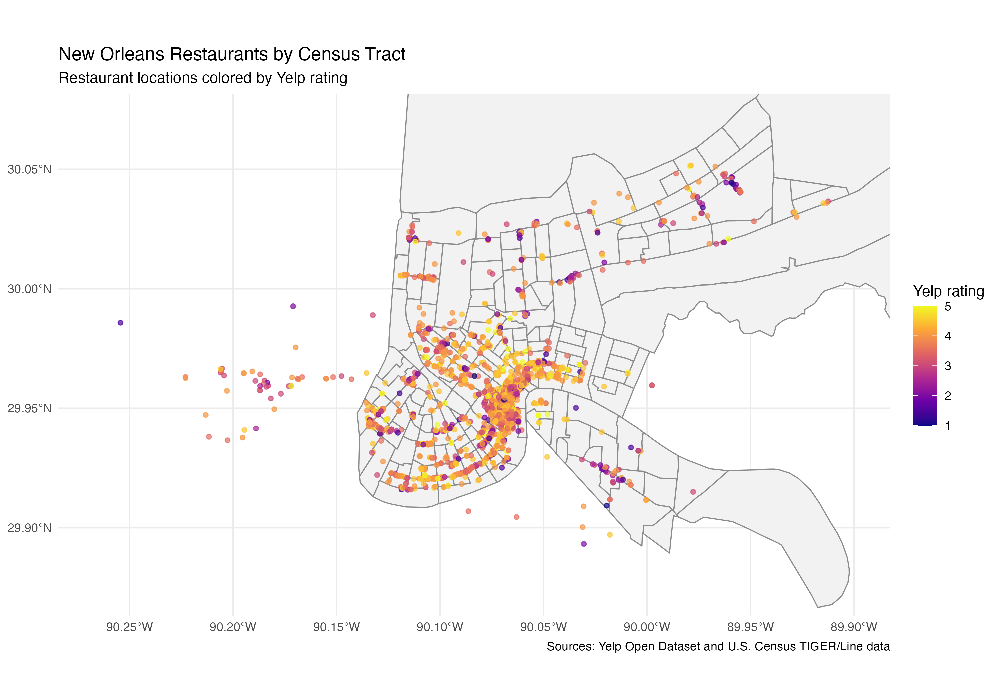
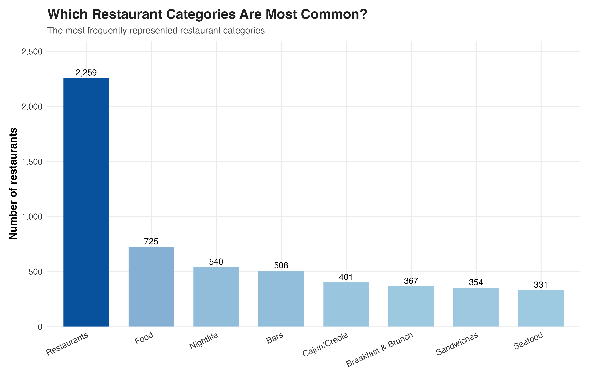
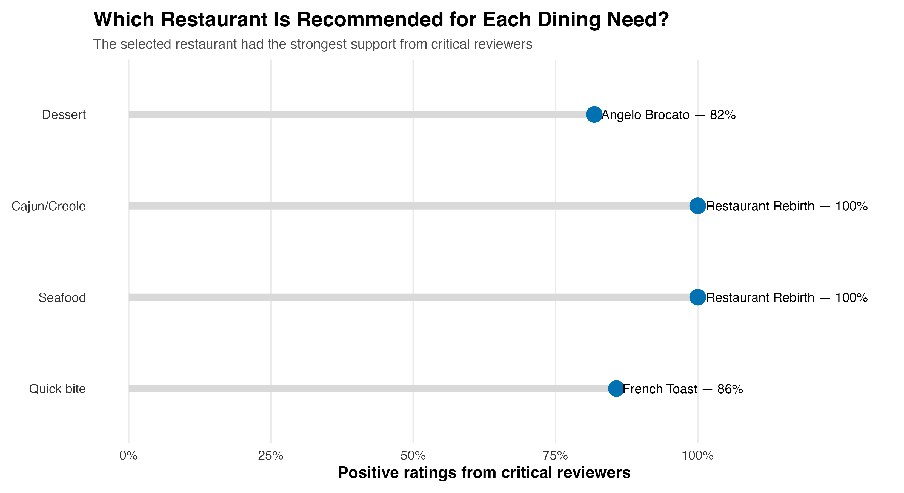
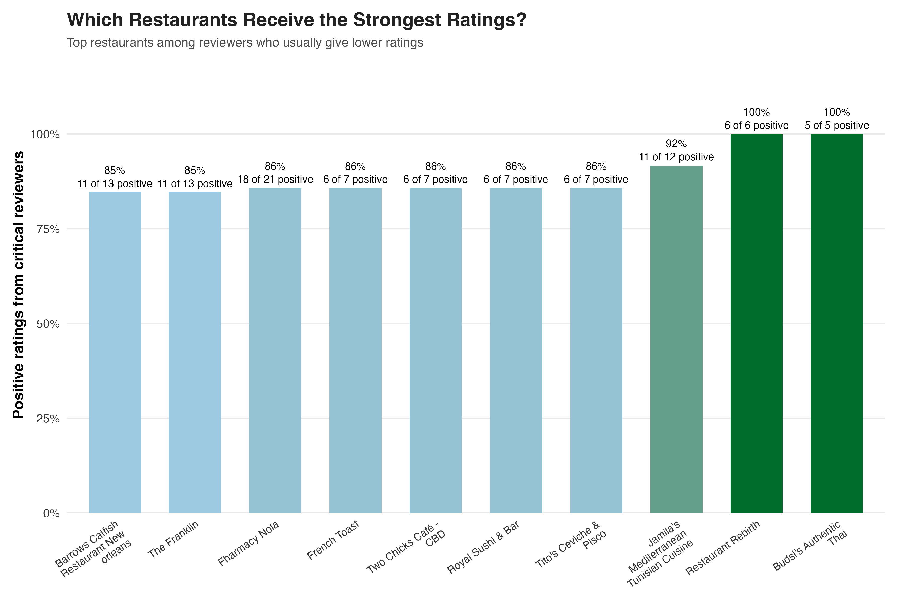
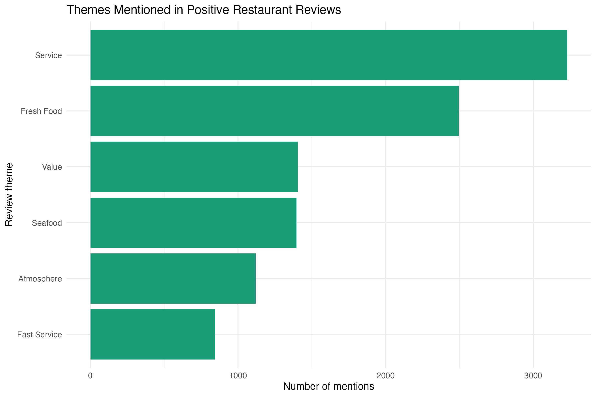
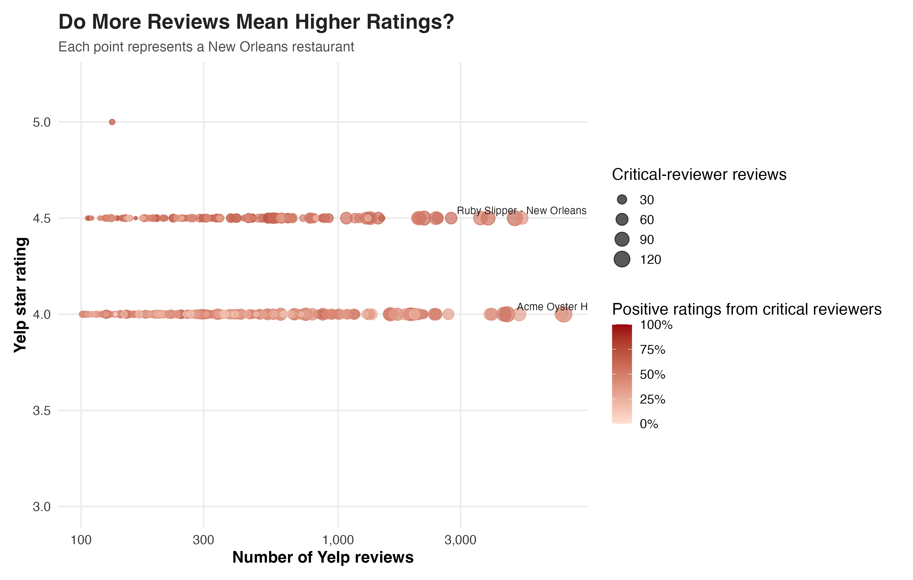

# Project overview

This project uses the Yelp Open Dataset to study restaurants in New Orleans. The analysis combines restaurant information, Yelp ratings, review counts, restaurant categories, geographic information, and review text.

The goal is to help visitors answer a practical question:

> **Which New Orleans restaurants are best suited for different dining needs, and what do Yelp reviewers say about those restaurants?**

The analysis focuses on four dining needs:

- Quick bite
- Seafood
- Cajun/Creole food
- Dessert

# Main findings

The strongest restaurant recommendations were:

| Dining need | Recommended restaurant | Yelp rating |
|---|---|---:|
| Quick bite | French Toast | 4.5 |
| Seafood | Restaurant Rebirth | 4.5 |
| Cajun/Creole | Restaurant Rebirth | 4.5 |
| Dessert | Angelo Brocato | 4.5 |

These restaurants were selected using Yelp star ratings, number of reviews, reviewer-adjusted results, and review themes.

# Question 1: Where are restaurants concentrated?

## Answer

Restaurants are not evenly distributed across New Orleans. The largest concentration of restaurants appears in central New Orleans ZIP codes, especially ZIP code **70130**.

ZIP code 70130 had the largest number of restaurants in this dataset, followed by ZIP codes 70115, 70116, 70112, and 70119.

This suggests that visitors looking for many restaurant choices should begin in the central and tourist-heavy parts of New Orleans.

The analysis also compared ZIP codes with Census tracts. ZIP codes were easier to interpret for visitors because they are familiar geographic areas. Census tracts provided a more detailed geographic comparison.

# Question 2: Which restaurant categories are most common?

## Answer

The most common restaurant categories include restaurants, bars, American food, seafood, Cajun/Creole food, breakfast and brunch, and sandwiches.

This shows that New Orleans has a wide range of food options. However, some Yelp businesses belong to multiple categories, so one restaurant may appear in several categories.

# Question 3: Which restaurants are best for different dining needs?

## Answer

The recommendations were created using several criteria:

- At least 4 stars
- A reasonable number of Yelp reviews
- Restaurant category
- Total review count
- Positive review themes
- Performance with critical reviewers

## Quick bite

**French Toast** was the strongest quick-bite recommendation. It had a 4.5-star Yelp rating and a substantial number of reviews.

Reviewers frequently mentioned breakfast food, sandwiches, service, and the overall dining experience.

## Seafood

**Restaurant Rebirth** was the strongest seafood recommendation. It had a 4.5-star rating and received positive reviews from critical reviewers.

Reviewers mentioned the food quality, service, atmosphere, and seafood dishes.

## Cajun/Creole

**Restaurant Rebirth** was also the strongest Cajun/Creole recommendation. This result is consistent with the restaurant's category information and its high rating.

## Dessert

**Angelo Brocato** was the strongest dessert recommendation. Reviewers frequently mentioned gelato, ice cream, pastries, desserts, and the restaurant's long-standing reputation.

# Question 4: Which restaurants impress critical reviewers?

## Answer

Some reviewers appear to be more critical than others. To study this, I identified reviewers who had written several reviews but gave relatively few high ratings.

A restaurant was considered successful with critical reviewers when it received positive ratings from these selective reviewers.

The results suggest that restaurants such as Restaurant Rebirth, French Toast, Pharmacy Nola, and other highly rated restaurants performed well with critical reviewers.

This provides additional information beyond the average Yelp rating. A 4-star rating from a selective reviewer may be especially meaningful because that reviewer does not give high ratings to every restaurant.

# Question 5: What do reviewers mention about the recommended restaurants?

## Answer

The review-text analysis searched for common themes in the reviews. The main themes included:

- Food quality
- Seafood
- Fresh food
- Fast service
- General service
- Value
- Atmosphere

These themes help explain why restaurants received positive ratings.

For example, a restaurant may have a high rating because reviewers repeatedly mention excellent food, good service, or a pleasant atmosphere. The themes provide context that a star rating alone cannot show.

# Ratings and review volume

A restaurant's review count can provide information about how much attention it has received from Yelp users. However, having more reviews does not automatically mean that a restaurant has a higher rating.

The graph below compares average ratings for restaurants with different review-volume groups:

- 100–499 reviews
- 500–999 reviews
- 1,000 or more reviews

The purpose is to see whether restaurants with more reviews also receive higher average ratings.

# Geographic area selected

The geographic area selected for this project is **Orleans Parish, Louisiana**.

The data was filtered using:

- State FIPS code: 22 for Louisiana
- County/parish FIPS code: 071 for Orleans Parish

This area was selected because New Orleans is located in Orleans Parish and because it contains the restaurants relevant to this project.

Within Orleans Parish, ZIP codes and Census tracts were used to compare restaurant concentration and restaurant characteristics.

# Data and cleaning

The project uses the Yelp Open Dataset, including:

- Business data
- Review data
- Restaurant categories
- Latitude and longitude
- ZIP codes
- Yelp star ratings
- Number of reviews
- Review text

The data-cleaning process included:

1. Importing large JSON files.
2. Filtering businesses to New Orleans restaurants.
3. Removing businesses without usable geographic coordinates.
4. Separating restaurant categories into individual categories.
5. Joining restaurant information with review information using `business_id`.
6. Creating summaries by ZIP code and Census tract.
7. Identifying critical reviewers.
8. Searching review text for common themes.
9. Creating tables, maps, and graphs.

# Limitations

This analysis has several limitations:

- Yelp reviewers are not a random sample of all restaurant customers.
- Yelp ratings may change over time.
- A restaurant's category labels may be incomplete or overlapping.
- Review text contains subjective opinions.
- The dataset does not include current prices, wait times, or restaurant availability.
- The analysis identifies patterns in Yelp data; it does not guarantee that every visitor will have the same experience.

# Source code

The R code used for this project is available in the repository:

- [Data import and New Orleans filtering](R/01_import_and_filter.R)
- [Restaurant category analysis](R/02_categories.R)
- [Restaurant ratings and review analysis](R/03_restaurant_analysis.R)
- [Critical reviewer analysis](R/04_picky_reviewer_analysis.R)
- [Review theme analysis](R/05_review_themes.R)
- [Geographic analysis](R/06_geography_analysis.R)
- [Restaurant recommendations](R/07_restaurant_recommendations.R)
- [Final findings and graphs](R/08_final_findings.R)

# Conclusion

The analysis suggests that Restaurant Rebirth, French Toast, and Angelo Brocato are strong choices for different dining needs in New Orleans.

The results also show that restaurant recommendations should not rely only on the average Yelp rating. Review volume, restaurant category, review themes, location, and performance with critical reviewers provide additional information.

Together, these analyses create a more complete way to understand which restaurants may be good choices for visitors in New Orleans.